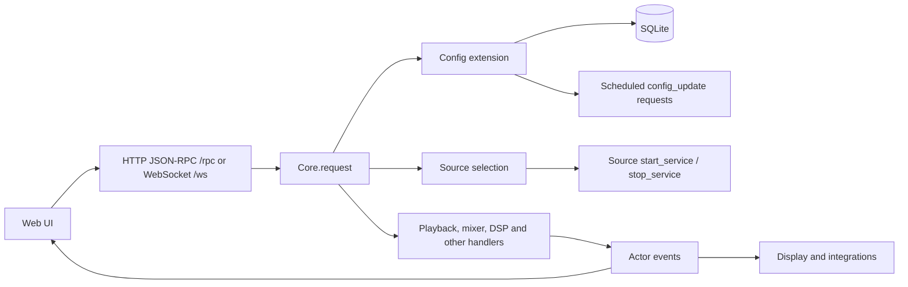
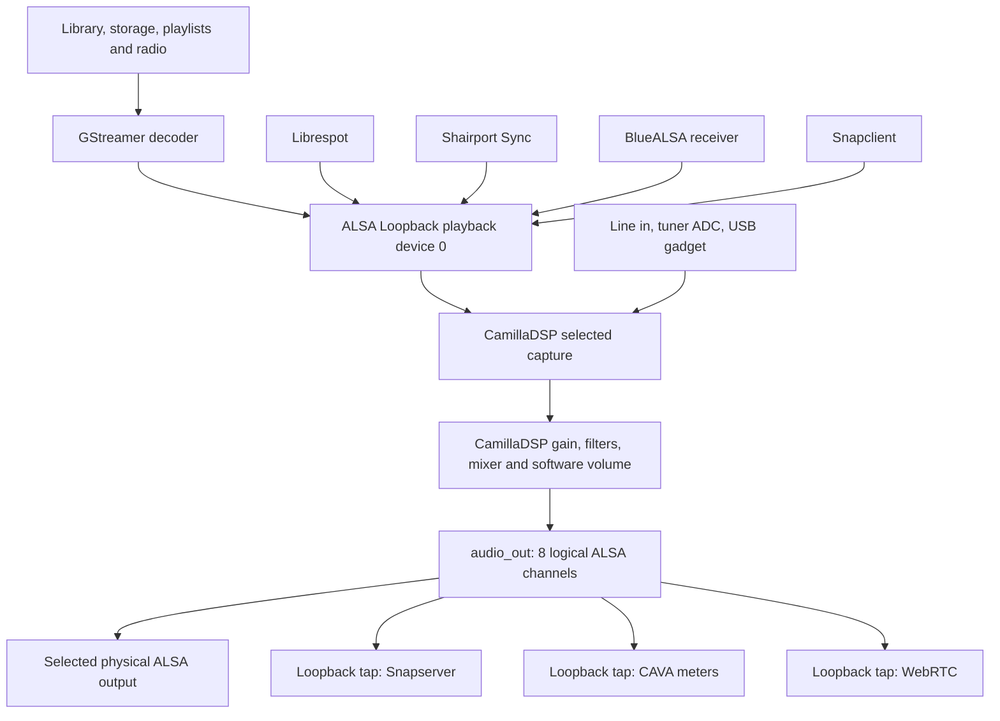

# Berryaudio architecture and feature map

Baseline: `c340e1b`, version `4.1.0`. Reviewed 2026-11-18.
This is a source-level map, not confirmation of an installed image's behavior.

## Runtime and extension model

[`main.py`](../../main.py) initializes GStreamer, selects an asyncio/GLib event
loop, and explicitly loads 25 extensions. `gpio` and `infrared` are commented out.
There is no automatic plugin discovery or extension enable/disable manifest.

[`core/core.py`](../../core/core.py) first imports all extension packages and seeds
their configuration, then constructs extensions and schedules their actor tasks.
The list order is not an awaited readiness sequence: startup work can interleave.

Each package exports `Extension` from `__init__.py`. Most classes inherit
[`Actor`](../../core/actor.py); a `SourceActor` also participates in the source
directory when it has a `_source` model. Visible sources include settings and
library pages, so a source entry does not necessarily produce audio.

Two communication paths have different behavior:

- `core.send(target=..., event=..., ...)` queues an event for one or more actors;
  omitted targets broadcast it. Actor queues process events sequentially.
- `await core.request("mixer.get_volume", ...)` directly invokes
  `MixerExtension.on_get_volume()`. It bypasses the actor queue. Concurrent RPCs,
  source switching, and settings application therefore can overlap.

`core._request()` schedules a request without waiting for its result; native
callbacks and background threads also use `asyncio.run_coroutine_threadsafe()`.
Routing for requests uses a class-name prefix, whereas event targets use registered
extension names. Missing request handlers log and return `None`.

`Core.stop_all()` explicitly calls `on_stop()` and then stops actor loops; the
actor loop also calls `on_stop()` in `finally`. Cleanup needs to tolerate repeat
calls. Readiness, operation locking, and failure propagation are relevant when
adding hardware features.

## Control path



[`web/web.py`](../../web/web.py) serves the UI on port 8080, accepts JSON-RPC 2.0
requests over `/rpc` and `/ws`, and forwards events to connected WebSockets.
Method names map to extension handlers; there is no separate REST API schema.
Example read-only request:

```json
{"jsonrpc":"2.0","id":1,"method":"config.get"}
```

The checked-in web server has no authentication layer, listens on all interfaces,
and allows cross-origin requests. A future privileged hardware endpoint must be
designed with this existing exposure in mind. This is an observation about the
server code; reverse proxies or installed-image restrictions were not inspected.

## Configuration and persistence

[`core/db.py`](../../core/db.py) creates a shared SQLite connection at
`core/db/library.db`, relative to the repository. `DB_PATH` is an unused constant;
it does not determine the actual database path. The directory is gitignored.
`check_same_thread=False` permits cross-thread access but is not an operation lock.

The `extensions` table stores one JSON configuration object per extension.

1. Each extension's `config.yaml` seeds a missing row with `INSERT OR IGNORE`.
2. `config.get` returns all database configuration objects.
3. `config.set` checks submitted extension/key names against the stored objects
   and updates them. Values do not have a general backend settings schema.
4. `ConfigExtension.on_set()` schedules each affected `config_update` handler,
   broadcasts `config_updated`, and returns `True` without awaiting application.

Consequences for feature work:

- Adding a YAML key does not add it to an existing installation's database.
  New settings require migration/default merging while retaining user values.
- Configuration spanning multiple extensions is not one atomic transaction.
- A successful save does not prove that the device, boot file, or service update
  worked. Add explicit application status where that distinction matters.
- Extensions retain the configuration snapshot passed to their constructors.
  They must refresh relevant cached values or implement `on_config_update()`.
- Some settings send `event="system", action="restart"`. The bundled UI opens a
  reboot dialog; `SystemExtension.on_event()` does not reboot on this event.
  An explicit `system.reboot` request performs the reboot.

Other persistence ownership:

| Data | Owner and storage |
| --- | --- |
| Indexed music, albums, artists, genres | `local`, SQLite tables |
| Station catalog | `radio/stations.json` seeds the `radio` table |
| Current queue | `tracklist.current_queue` in extension configuration |
| Saved playlists | `playlist` table, serialized track lists |
| Favorites and listening history | `collection_favourite`, `collection_history` |
| Tuner stations | `tuner` table |
| CamillaDSP processing graph | `dsp/camilladsp/configs/camilladsp.yml` |
| CamillaDSP state | `dsp/camilladsp/statefile.yml`, includes an absolute path |
| Artwork | Mutable files beneath `web/www/images/` |
| ALSA output routing | Installed `/home/pi/.asoundrc`, absent from repository |

## Audio path



The `audio_out` fan-out in this diagram is inferred from the CamillaDSP channel
mapping and consumer device names. Its actual ALSA plugin composition and bindings
cannot be reconstructed conclusively without the installed `.asoundrc` and any
included files.

### Producers and capture switching

| Path | Code and behavior |
| --- | --- |
| Local files and internet radio | `playback` builds `uridecodebin -> audioconvert -> audioresample -> alsasink`; sink is `mixer.output_device` |
| Spotify | `spotify` launches `/usr/local/bin/librespot`; its own `spotify.output_device` defaults to Loopback |
| AirPlay | `shairportsync` launches Shairport Sync and a metadata reader; ALSA target is `mixer.output_device` |
| Bluetooth reception | `bluetooth` launches `bluealsa-aplay` targeting `mixer.output_device`; obtains format/rate through BlueALSA |
| Multiroom reception | `multiroom` launches Snapclient targeting `multiroom.client_device`, default Loopback |
| Line in and tuner | Select configured ALSA capture directly through `dsp.set_capture_device`; tuner additionally controls SI4703 and an optional analog mux |
| USB DAC mode | Captures `UAC2Gadget`; `usbdac` also edits USB boot/module configuration |

[`source/source.py`](../../source/source.py) stops the previous source service and
starts the next one. Audio services generally ask `dsp.set_capture_device(...,
ext=source_name)` to configure CamillaDSP before it calls their `start_stream`.

[`playback/playback.py`](../../playback/playback.py) first probes decoded sample
rate, tears down the probing pipeline, requests the corresponding DSP capture
settings, and then starts a new pipeline. Sample-rate changes interact with source
startup and multiroom; they are not just a sink property.

### CamillaDSP and downstream consumers

[`dsp/dsp.py`](../../dsp/dsp.py) controls a separate CamillaDSP process through
`CamillaClient` at `127.0.0.1:1234`. It reads/writes the tracked processing YAML,
applies configuration over the client, requests reload, and waits for RUNNING.
Normal startup connects to an already provided service; it does not launch the
binary. `dsp.service` invokes `systemctl` for `camilladsp.service`.

Current defaults are Loopback capture, gain -15 dB, and fixed output rate 48 kHz.
With a fixed rate, capture switching sets `capture_samplerate` to the source rate
and forces the resampler type to `Synchronous`. With no fixed rate, it removes
the resampler and changes the processing/output rate to the source rate.

The checked-in processing YAML is a saved example with USB gadget capture,
96 kHz settings, enabled EQ, and an eight-channel `Distributer` mixer. Startup
overrides parts of it; it is not a clean installation template. Output channels:

| Logical indices | Labels in checked-in mixer | Consumer evidence |
| --- | --- | --- |
| 0, 1 | DAC R, DAC L | Physical output inferred; source indices are 1, 0 |
| 2, 3 | Multiroom R, Multiroom L | `multiroom.server_device = hw:Loopback,1,1` |
| 4, 5 | Spectrum R, Spectrum L | CAVA configs capture `hw:Loopback,1,2` |
| 6, 7 | Web RTC R, Web RTC L | WebRTC captures `plughw:Loopback,1,3` |

These eight channels represent four stereo destinations. They do not establish
eight-channel physical I²S capability. Verify left/right on hardware before
changing the saved mixer's reversed input indices.

[`mixer/mixer.py`](../../mixer/mixer.py) chooses an ALSA hardware volume control
or delegates volume/mute to CamillaDSP. `mixer.hw_device` selects the final output
through `.asoundrc`; `mixer.output_device` is the upstream Loopback target.
Bluetooth transmission temporarily replaces the final target with `bluealsa`
and restarts the CamillaDSP service, restoring the configured device on disconnect.

[`multiroom/multiroom.py`](../../multiroom/multiroom.py) manages Snapcast processes,
discovery, metadata and RPC. Snapserver reads the dedicated Loopback tap and obtains
rate/format reporting from `dsp.get_capture_device`. CAVA configuration is fixed
at 48 kHz. [`webrtc/webrtc.py`](../../webrtc/webrtc.py) serves `/stream` on port 8082,
records a separate tap at 48 kHz/S16_LE through `plughw`, and sends audio via aiortc.

## Where to implement other features

| Feature area | Primary files | Important coupling |
| --- | --- | --- |
| Audio hardware, I²S, volume | `mixer/mixer.py`, `mixer/mixers.json`, `core/util/system.py` | Boot overlays, ALSA graph, Bluetooth output override |
| EQ, routing, format/rate policy | `dsp/dsp.py`, CamillaDSP YAML | All source lifecycles, gain, software volume, taps |
| New input source | `source/source.py`, sibling `SourceActor` implementations, `main.py` | `Source`, metadata, controls, capture/start callback |
| Local library and tags | `local/local.py`, `core/util/metadata.py` | SQLite, storage URIs, artwork paths |
| Queue and transport | `tracklist/tracklist.py`, `playback/playback.py` | Source lookup/playback URIs, repeat/random, metadata events |
| Playlists/favorites/history | `playlist/`, `collection/` | Serialized models and `__model__` aliases |
| Filesystem and NAS | `storage/storage.py`, `storage_manager.py`, `smb_manager.py` | UDisks2, CIFS mounts, Samba credentials/config |
| Network and hotspot | `network/network.py` | NetworkManager/nmcli, periodic WLAN monitor |
| OLED/local controls | `display/`, `gpio/`, `infrared/`, `command/` | Hardware pins, CAVA, event names, two disabled extensions |
| Power/system information | `system/system.py` | OS commands, standby source clearing, timezone |
| Web/API/UI | `web/web.py`, bundled `web/www/assets/index.js` | JSON-RPC methods/events; frontend source is missing |
| Browser audio | `webrtc/webrtc.py` | Dedicated loopback tap and separate event-loop thread |
| Shared data models | `core/models/`, `core/types/`, `core/util/__init__.py` | Pydantic types, serialization, command/state enums |

`mixer/local/` contains another `LocalExtension` implementation. It is not loaded
by `main.py`; the active library code is top-level `local/`.

### Hardware resource references

These are source constants, not a measurement of the installed pinmux. Check the
complete board wiring and overlays before assigning DSP reset/mute/control pins.

| Existing device | Resource in source | Location |
| --- | --- | --- |
| SSD1322 OLED | SPI port 0/device 0, DC GPIO24, reset GPIO25 | `display/ssd1322/__init__.py` |
| SSD1306 OLED | I²C bus 0, address 0x3c | `display/ssd1306/__init__.py` |
| MCP23017 buttons/encoder | I²C bus 1, address 0x20, interrupt GPIO23; extension disabled by default | `gpio/mcp23017/__init__.py`, `main.py` |
| SI4703 tuner | I²C bus 1, address 0x10, reset GPIO16 | `tuner/tuner.py`, `tuner/si4703.py` |
| Berryaudio analog input mux | GPIO4 | `tuner/tuner.py` |

## Deployment and development boundary

- `requirements.txt` pins Python dependencies and two Git commits of forked
  CamillaDSP Python packages. The CamillaDSP executable/version and OS packages
  are not pinned by this repository. Verify custom effect support on the target.
- `setup.py` declares only `py_modules=["main"]` and a console script. It does not
  package all extensions/assets or declare the full deployment environment.
- React/TypeScript is described in README, but this checkout contains only the
  built JavaScript/CSS/assets: no frontend package manifest, TSX sources, source
  maps, or reproducible frontend build configuration were found.
- No automated tests, CI workflow, systemd unit files, image provisioning scripts,
  ALSA graph template, or boot template were found among tracked files.
- OS integrations include GStreamer plugins/GObject introspection, ALSA utilities
  and `snd-aloop`, BlueZ/BlueALSA, NetworkManager, UDisks2, Samba/CIFS, CAVA,
  CamillaDSP, Librespot, Shairport Sync, Snapcast and GPIO/I²C/SPI support.
  Some optional paths import `smbus2`/`evdev`, absent from `requirements.txt`.
- Paths such as `/home/pi/.asoundrc`, `/home/pi/.xinitrc`, `/home/pi/Internal`,
  `/usr/local/bin/*`, `/boot/firmware/*`, and `/etc/modprobe.d/g_audio.conf`
  assume an appliance installation. Startup can edit system configuration,
  disable Bluetooth, and start hotspot management; it is not a harmless desktop
  inspection command.

See [findings](findings.md) for confirmed issues and verification boundaries,
[I²S proposal](i2s-external-dsp.md) for implementation decisions, and
[interface inventory](interfaces.md) for handlers, calls, events and defaults.
