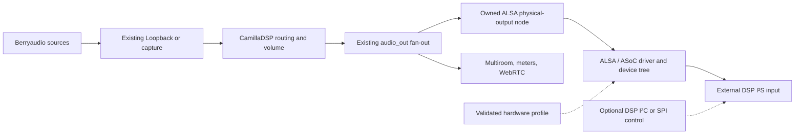

# Configurable I²S connection to an external DSP

Design proposal, 2026-11-18, based on `c340e1b` / Berryaudio `4.1.0`.
No hardware implementation or hardware validation has been performed.

Current target: the user confirmed Raspberry Pi 4, ADAU1701-based LSWEQ DSP-AMP 4,
and Pi-to-DSP audio only. Read the [target-specific note](rpi4-lsweq-dsp-amp4.md)
first; the alternatives below remain a general reference.

## Recommendation

Start with stereo audio from the Pi to the external DSP, at a fixed sample rate
supported by that DSP. Keep the existing source selection, Loopback ingestion,
CamillaDSP volume and output fan-out. Make the physical ALSA destination and its
hardware profile explicit. Add DSP programming/control separately if the board
requires it.

Send-only direction is confirmed. Stereo is the proposed first implementation.
DSP-to-Pi capture and a return processing loop are outside the current scope.



I²S integration belongs at the ALSA/ASoC boundary. There is no need to implement
sample transmission in Python. Berryaudio should select and validate the sound
device that the kernel exposes.

## What the repository already provides

- `mixer/mixers.json` has Generic-I2S profiles for `hifiberry-dac` and `i2s-dac`.
  It also lists Beocreate and HiFiBerry DAC+ DSP using `hifiberry-dac`.
- `mixer.list` returns that catalog; `mixer.alsa_devices(cmd="aplay")` provides
  discovered hardware PCMs; `mixer.alsa_mixer_volume` enumerates volume options.
- Mixer settings select `hw_device`, `dtoverlay` and a volume control. Changes
  edit boot configuration and `.asoundrc`, then request a reboot dialog.
- DSP settings already offer a fixed processing/output sample rate through
  `dsp.resample_rate`, default 48000.
- Software volume and mute work through CamillaDSP when no ALSA mixer is selected.

A compatible send-only board might therefore work with existing device selection
after the correct hardware setup. That is a hypothesis to prove on the actual Pi,
not evidence that an arbitrary DSP works with either generic profile.

The compiled Mixer UI uses the static catalog for its Audio Device dropdown.
The generic ALSA-discovery dropdown is used elsewhere; a newly discovered card
does not automatically become a Mixer catalog entry. The manual overlay field
does not solve that catalog-selection limitation.

## Audio transport and DSP management

I²S carries PCM audio. DSP presets, filter programming, reset, mute pins, amplifier
enable, and status reporting are separate board-specific operations. A DSP might
self-boot from EEPROM, or need a host to load its program before accepting audio.
Determine which applies before defining a control API.

Keep the existing CamillaDSP extension responsible for software processing.
If external DSP control is needed, add a distinct `external_dsp` extension or
board-specific controller with a small interface such as `status`, `set_mute`,
`set_volume`, `load_preset` and `ready`. Introduce only operations the actual board
supports. Do not interpret existing `dsp.set_config` as an external DSP API.

For the initial transport feature, retaining CamillaDSP provides volume, gain,
resampling, metadata/source coordination and the existing taps. Optional neutral
processing can disable EQ/effects while preserving routing and deliberate volume
policy. Existing saved gain/EQ and volume mean this is not automatically bit-perfect.

| Approach | Benefit | Work / limitation |
| --- | --- | --- |
| Keep CamillaDSP and select I²S endpoint | Smallest change to existing source and tap behavior; recommended first version | Decide which processing remains active and validate format/clock policy |
| Route every source directly to external DSP | Removes software processing from transport | Replace CamillaDSP-dependent volume, capture switching, multiroom/visualizer/WebRTC fan-out and source startup coordination |
| Send to DSP and capture processed return | Lets Pi consume processed audio | Requires capture-capable hardware description, shared-clock analysis, deliberate return routing and feedback prevention |

## Hardware decisions that constrain the implementation

Record the board model/revision and its datasheet for each supported profile.

| Decision | Required information |
| --- | --- |
| Pi platform | Model, OS image, running kernel and available overlays |
| Direction | Pi-to-DSP only, DSP-to-Pi only, duplex, or processing return loop |
| Timing owner | Which device produces BCLK and LRCLK; whether DSP requires continuous clocks |
| Audio format | Standard I²S versus another serial mode, channel order, polarity/edge requirements |
| Data layout | Valid sample bits, serial slot width, number of slots and data lanes |
| Sample rate | DSP's supported/fixed rates, and handling of differing source rates |
| DSP system clock | Whether an external MCLK/oscillator is required and where it comes from |
| Physical interface | Logic voltage compatibility, common ground, connector and wiring length |
| Board lifecycle | Power, reset, program load, readiness/lock indication, mute and shutdown order |
| Existing peripherals | Pin conflicts with display, tuner, GPIO controls, SPI/I²C and audio HATs |

The usual first-lane header mapping is GPIO18/BCLK (pin 12), GPIO19/LRCLK (35),
GPIO21/Pi data out (40), and GPIO20/Pi data in (38). Use only the directions
required. Exactly one device produces the bus clocks. Pi 5's RP1 implementation
differs from earlier Pis, including multiple data lanes. Native MCLK output and
TDM are not supported by the documented Raspberry Pi I²S peripherals. These facts
are summarized from the [Raspberry Pi I²S white paper](https://pip-assets.raspberrypi.com/categories/1259-audio-camera-and-display/documents/RP-009699-WP-1-Using%20the%20I2S%20peripherals%20on%20Raspberry%20Pi%20SBCs.pdf).

An external DSP needing MCLK may supply its own oscillator or require additional
clock hardware. The DSP datasheet must settle that question; choosing a sample
rate in Berryaudio cannot create a missing system clock.

Use the DSP's valid sample precision and serial slot width as separate concepts.
For a proposed two-slot, 32-bit-slot link at 48 kHz, the expected BCLK is
`48000 × 2 × 32 = 3.072 MHz`. This does not imply 32 valid audio bits. Verify the
driver's slot configuration and observed signals; an ALSA memory format alone
does not establish the wire format.

## Overlay choices

For the inspected Raspberry Pi kernel branch `rpi-6.12.y`:

| Timing arrangement | Candidate | Evidence / qualification |
| --- | --- | --- |
| Pi produces BCLK/LRCLK; DSP consumes | `i2s-dac`, if its driver capabilities match the board | Overlay enables `i2s_clk_producer`; no arbitrary slot or format controls are exposed |
| DSP produces BCLK/LRCLK; Pi consumes | `i2s-master-dac`, if supported on the installed kernel | Overlay enables `i2s_clk_consumer`, external bit/frame clock ownership, two 32-bit slots and I²S format |
| Duplex or another layout/protocol | Board-specific overlay/driver or a custom maintained sound-card description | Playback-only generic profiles do not establish capture support or configurable serial parameters |

Sources: [i2s-dac overlay source](https://github.com/raspberrypi/linux/blob/rpi-6.12.y/arch/arm/boot/dts/overlays/i2s-dac-overlay.dts),
[i2s-master-dac overlay source](https://github.com/raspberrypi/linux/blob/rpi-6.12.y/arch/arm/boot/dts/overlays/i2s-master-dac-overlay.dts),
and [overlay reference](https://github.com/raspberrypi/linux/blob/rpi-6.12.y/arch/arm/boot/dts/overlays/README).
The latter name describes the external device as clock producer. Check the
installed kernel/overlay version rather than inferring timing direction from
the word “master.” These are candidates, not tested recommendations for an
DSP board. The current target-specific note selects a candidate for the identified
module; it has not been tested on hardware.

Prefer known, validated profiles over exposing arbitrary GPIO, format and clock
values as if they could all be changed at runtime. Some settings require a new
device-tree description, driver support, and reboot. Fixed pins/capabilities can
be shown as profile information instead of editable controls.

## Proposed configuration model

For the first implementation, extend `mixer` and retain `dsp.resample_rate` as the
single existing authority for nominal output rate. Avoid a second competing
sample-rate setting. Keep Loopback source settings intact.

Illustrative settings only; new keys do not exist in the current application:

```yaml
mixer:
  output_device: hw:CARD=Loopback,DEV=0  # existing source ingestion
  hw_device: hw:CARD=DISCOVERED_CARD_ID,DEV=0
  hw_device_id: null                    # existing catalog ID, when applicable
  dtoverlay: i2s-dac                    # candidate only after hardware validation
  volume_device: Software              # current CamillaDSP volume backend
  output_profile: external-dsp-stereo-pi-clock  # proposed
  sample_format: S32_LE                 # proposed; validate actual driver support
  channels: 2                          # proposed physical count, not fan-out size
dsp:
  resample_rate: 48000                  # example; derive from DSP requirements
```

Store immutable profile capabilities separately, extending the catalog or using
an associated profile file:

- Stable profile identifier, display name, transport, supported Pi/kernel range.
- Overlay and supported parameters, clock role from the Pi's perspective,
  serial protocol, physical pins/lanes, slot layout and channel order.
- Allowed rates/formats and whether capture exists.
- MCLK requirement and source, control-backend reference if needed.
- Fields requiring reboot versus service restart versus live update.

Use stable ALSA card IDs resolved on the target; a generic catalog card name may
differ by kernel/driver. Discovery should verify the selected card after reboot.
Do not promise to probe all capabilities from `aplay -L`: that lists PCMs, not
every constraint of the DSP connected to a generic codec driver.

Backend validation should reject incompatible rate/format/profile combinations,
unsafe duplicate clock producers, unsupported directions and unmanaged pin
conflicts. Where values cannot be detected, validate against the board profile.
The current untyped database settings path needs migration and validation support
before accepting the proposed fields.

## Routing and clock handling

### Own one physical-output node

Obtain the installed `.asoundrc`, all referenced includes and Loopback module
options first. Preserve `audio_out`'s logical channel layout and consumers. Add an
explicitly managed node such as `pcm.berryaudio_hardware` and bind the physical
stereo pair to it. This node is a proposal; it does not exist in the repository.

ALSA `hw` opens the driver without conversions; `plug` can convert format/rate or
channels. `multi` can combine multiple PCM endpoints, with `route`/bindings used
to establish channel assignment. Choose conversion deliberately and keep auxiliary
streams out of the physical endpoint. See the [ALSA PCM plugin reference](https://www.alsa-project.org/alsa-doc/alsa-lib/pcm_plugins.html).

Replace only the owned physical target when Bluetooth transmission overrides the
output. On disconnect, restore it from current persisted settings, not an old
constructor snapshot. Do not replace all PCM strings in an arbitrary ALSA file.

If the installed graph uses `multi`, verify its rate, format and timing constraints
across hardware and Loopback endpoints. Changing CamillaDSP playback directly
from eight-channel `audio_out` to a stereo `hw:` device would require changing the
graph and preserving its consumers elsewhere.

### Distinguish rate conversion from clock drift

Fixed conversion, such as 44.1 to 48 kHz, and drift between independent devices
are different requirements. Upstream CamillaDSP documents asynchronous resampling
for adjustable rate matching; some ALSA Loopback/USB gadget capture paths can
tune their virtual clocks instead. Inspect the installed version and control
support before choosing a policy. The current code overwrites a configured
resampler with `Synchronous` on capture switches. See [CamillaDSP resampling and
rate adjustment](https://github.com/HEnquist/camilladsp#resampling) and its
[capture/playback FAQ](https://github.com/HEnquist/camilladsp/blob/master/FAQ.md#capture-and-playback).

For each source, identify the real clock relationship: paced Loopback, independent
ADC, USB gadget or external DSP capture. A clock-producing DSP also fixes the
wire timing; Berryaudio's configured rate must match it. A DSP's internal ASRC does
not automatically correct the Pi's separate capture/playback timing.

Report source rate/format and negotiated output/tap rate/format separately.
Monitor buffer level and XRUNs under long playback; identical nominal rates are
insufficient evidence of synchronization. Preserve the chosen rate policy through
source changes, standby and reconnects.

### Volume and mute

Use existing CamillaDSP software volume first unless the board requires a different
policy. If an external controller owns volume, explicitly select that backend
and define initial gain, persistence, mute and reconnect behavior. Avoid silently
assuming the DSP starts at an attenuated volume. Gate unmute on readiness when
the board exposes that signal, and coordinate external mute with program changes.

## Concrete implementation sequence

### 1. Prove the hardware endpoint

- Record Pi/DSP specifications and installed service/kernel versions.
- Snapshot boot configuration and ALSA graph/includes without changing them.
- Select the correct clock/direction profile and establish the ALSA card.
- Check clocks, serial framing and separate left/right playback at one supported
  fixed rate. Test missing-clock behavior if the DSP produces clocks.

If the existing generic profile is compatible, this phase may need configuration
and catalog changes only. Do not expand to a custom driver before that is proven.

### 2. Make output configuration maintainable

- Add profile metadata, validated output settings and configuration migration.
- Introduce a managed ALSA template/node and a boot block/include with atomic
  writes, backups, explicit failures and restoration of the last working setup.
- Serialize route changes; quiesce sources/CamillaDSP before replacing a graph.
- Distinguish saved, pending reboot, applied and failed states. Validate hardware
  after reboot and avoid claiming success solely because settings were persisted.
- Keep the external DSP initialization/mute hook small and optional.

### 3. Integrate all producers and controls

- Apply selected output format and fixed rate without changing Loopback ingestion.
- Preserve taps; verify source switching, Bluetooth transmission override/restore,
  standby and startup with unavailable hardware.
- Correct capture-format propagation and relevant settings defects from
  [findings](findings.md), if capture/format configuration is part of the feature.
- Expose profile selection, supported rates/formats, clock direction, physical
  connection summary and applied status in the UI. Obtain the frontend source
  before building a maintained settings page; do not edit the minified bundle.

An optional later phase can add a neutral CamillaDSP profile, external preset
management, duplex capture or alternate direct-output mode as separately scoped
features once the first endpoint is stable.

## Files likely to change

| Area | Files |
| --- | --- |
| Output profile and compatibility metadata | `mixer/mixers.json`, optional new profile file |
| Output selection/volume policy | `mixer/mixer.py`, `mixer/config.yaml` |
| Migration and apply-state reporting | `core/db.py`, `config/config.py`, optional settings models |
| Managed ALSA and boot files | `core/util/system.py`, new versioned templates/helpers |
| Output format, rate and readiness | `dsp/dsp.py`, maintained CamillaDSP configuration/template |
| Alternate output overrides | `bluetooth/bluetooth.py` |
| Optional DSP program/control lifecycle | New `external_dsp/` or board-specific controller; `main.py` if an extension |
| Tap compatibility | `multiroom/`, `display/widgets/`, `webrtc/` as actual routing changes require |
| Settings UI | Frontend source repository, currently absent |

## Acceptance checks for implementation

Meaningful automated checks should cover migration of an existing database,
preservation of unrelated ALSA/boot nodes, duplicate/repeated application,
validation failures, missing anchors/devices, serialized changes and rollback.

Hardware checks should cover:

- Cold boot, warm reboot, startup without DSP readiness and recovery.
- Observed BCLK/LRCLK/framing and correct separate L/R signal assignment.
- Supported source rates, explicit output format, and documented rejection of
  unsupported combinations.
- Local playback, radio, Spotify, AirPlay, Bluetooth RX/TX, line in/tuner/USB gadget
  where available, and Snapcast reception/transmission.
- Volume/mute, standby/resume, source/rate changes and output restoration.
- Continued multiroom, CAVA and WebRTC operation with the chosen graph.
- Long playback with XRUN/buffer monitoring and multiroom latency measurement;
  external DSP delay may need compensation.

The [target-specific note](rpi4-lsweq-dsp-amp4.md) records the selected Pi/module
and proposed profile. Exact connector wiring and compatibility remain unverified.
